සිතන්න ඔබ කිසියම් **Software** එකක් නිර්මාණය කරනා විට ඔබ අතින් සිදු කරනා කිසියම් **Modification** එකක් නිසා ඔබ කලින් නිර්මාණය කරන ලද හොඳින් ක්‍රියාත්මක වූ **Software** එක නිසි ආකාරයෙන් ක්‍රියාත්මක නොවන අවස්ථාවක්.

සමහරවිට මෙය ඔබ **Modification** එක සිදු කරන ලද ස්ථානයේ නොව එය හේතුකොටගෙන වෙනත් ස්ථානයක ඔබට ඇස නොගැසෙන ලෙස සැඟව ඉන්න පුලුවන්. ඔබට පසුව පරිශීලකයෙක් මෙය ගැන පැමිණිලි කරනා විට ඔබ කලින් යෙදූ **Modification** එකද සෑහෙන තරමක් දුරට ඉදිරියට ගෙන ගොස් තිබෙන්න ඇති හැකියාව ඉහලයි. දැන් ඔබ පත්වෙලා ඉන්නෙ අපහසු අවස්ථාවකට. සමහරවිට ඔබ එම වෙනස්කම සිදු කරනා විට මෙය දැනගත්තානම් ඔබට එම **side effect** එක මගහරවා ගන්න තිබුණා.

ඔබ **Team** එකක වැඩ කරනවානම් තත්වය තවත් දරුණුයි. කිසියම් සාමාජිකයෙක් කරනාලද වෙනස්කමක් නිසා ඔබ සිදු කරන වෙනස්කම් නිසිලෙස පද්ධතිය තුල ක්‍රියාත්මක නොවෙන්න පුලුවන්. නමුත් ඔබත් ඔහුත් මේක දැනගන්නෙ සමහරවිට **release** එක කරාට පස්සෙ වෙන්න පුලුවන්. එවිට වෙනසක් කිරීම දෙදෙනාටම අපහසුයි.

එවිට ගන්න තීරණයක් නිසා සියළු සාමාජිකයන් මෙම පද්ධතිය නිසි ලෙස **test** කලාට පසුව release කරන්න තීරණය කරනවා. මේ අවස්ථාවේ එන ගැටළුව තමා අළුතෙන් *feature* එකක් හෝ *bug fix* එකක් ප්‍රධාන කේතයට ඇතුල් කරන්න **කොපමණ කාලයක්** යාවිද කියන එක.

මෙම සියල්ල කරනා විට ඔබ භාවිතා කරන කිසියම් Programming Language එකක් එහි **Major Release** එකක් කරනව. එහි ඇති ගුණාංග නිසා ඔබට ඕන වෙනවා මෙහි Release එකක් එම Language Version එක සඳහාත් කිරීමට. නමුත් එම version එකට ඔබේ code එක නොගැලපුනොත් එතනත් ගැටලුවක්.

සියල්ල විසඳුවට පස්සෙ ඔබට වෙනව විවිධ OS වලටත් මේක වැඩද බලන්න.

මේ සියල්ල කිරීමට විශාල කාලයක් වගේම ශ්‍රමයක් වැය කරන්න ඕන.

ඔබට වැටහෙනවා ඇති මෙවන් අවස්ථාවකට මුහුණ දෙන්න ක්‍රමවත් වැඩපිළිවෙලක අවශ්‍යතාවයක් තිබෙන බව.

---

මෙය ක්‍රමවත්ව හසුරුවාගෙන වේගවත්ව **Development** කටයුතු කිරීමට සහ හැකි ඉක්මණින් **Releases** කිරීමට හැකිවන ලෙස සකසාගත් ක්‍රමවේදයක් තමා **Continuous Integration and Continuous Delivery** හෙවත් **CI/CD** කියන්නෙ.

> CI/CD වලට යන්න පෙර අප දැනගන්න අවශ්‍යයි Version Control System ගැන.

## Version Control Systems (VCS)

**VCS** ගැන කියනවනම් **git** කියන වචනය අපට අමතක කරන්න බෑ. නිකමට හෝ කනට ඇහිලා තියන වචනයක් බොහෝ අයගෙ.

**VCS** එකක අවශ්‍යතාවය පැමිණෙන්නෙ කිසියම් අලුත් *feature* එකක් හෝ *bug fix* එකක් code එකට එක් කරන විට සහ **develop** කරන විට.

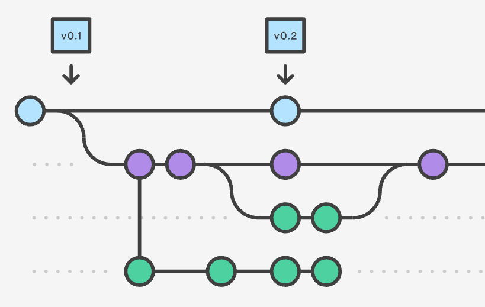

ඔබේ project එක VCS එක තුල **repository** හෙවත් **repo** යන කෙටි නමින් හදුන්වනවා..

ඉහත රූපය හොඳින් බලනා විට ඔබට පේනව ඇති **අතු** බෙදුනු සංකල්පයක්. මේක **branches** කියල තමා හඳුන්වන්නෙ.

**සම්මතයක් ලෙස master යන branch එක තුල තමා නිවරදිව ක්‍රියාත්මක වන code එක තබාගන්නෙ.**

නවතම *feature* එකක් හෝ *bug fix* එකක් වෙනම branch එකක සිදු කරන එක සාමාන්‍යෙන් සිදු කරනවා.මෙහිදී වාසිය වෙන්නෙ **VCS tool** එක මගින් අපි කරන වෙනස්කම් **track** කරනව. එහිදී පෙර අවස්ථාවකට code එක **restore** කරන්න හෙවත් **revert** කරන්න අපිට පුලුවන්. වෙනම branch එකක් ගත්තම ඒකෙ සිදු කරන වෙනස්කම් වලින් අනෙක් branches වෙනස් වෙන්නෙ නැති නිසා ඔබ කරන අත්හදාබැලීම **master branch** එකය බලපාන්නෙ නෑ

අදාල *feature* එක හෝ *bug fix* එක **master branch** එකේ කේතය සමඟ එකතු කිරීමට merge කිරීම යයි කියනු ලබනව. මෙහිදී ඔබේ නව කේතයෙහි ඇති වෙනස්කම් **master branch** එකට එක් වෙන එකයි සිදුවන්නෙ.

ඔබට මෙම *project* එක ඔබේ පරිගණකයේ හෝ වෙනත් පරිගණකයක තබගන්න පුලුවන්. *Team* එකක් ලෙස වැඩ කරනාවිට **සියල්ලටම පහසුවෙන් access ලබාගතහැකි server එකක්** යොදාගන්නවා.

මෙහිදී [**Github**](http://github.com) සහ [**Gitlab**](http://gitlab.com) වැනි ආයතන **තවත් සේවාවන් සමගින්** *users* ලා හට *project manage* කිරීමට **git repository** ලබාදීම කරනවා. මෙම වෙනත් පරිගණකයක ඇති **repository** එකක් **remote** එකක් ලෙසයි සලකන්නෙ.

> ඉදිරියට යාම සඳහා ඔබේ **OS** එකට අදාලව **git install** කරගැනීම කල යුතු වෙනවා. ඒ සඳහා මෙම [link](https://git-scm.com/downloads) එකෙන් ඔබේ OS එකට අදාල ක්‍රමයට install කරගන්න.

*git install වූ පසු* ඔබේ **command line** එකෙන් **git** ලෙස type කල විට පහත අයුරින් දිස්වනු ඇත.

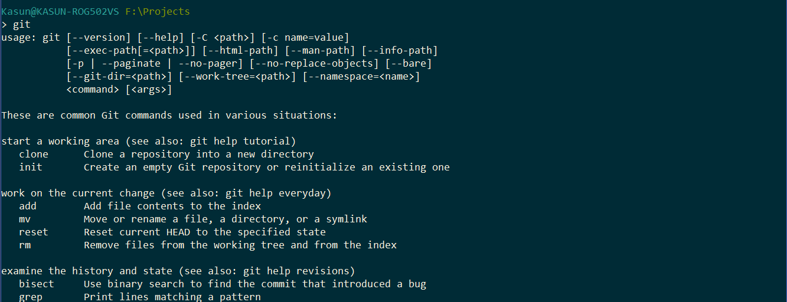

> මෙම tutorial එක සඳහා [Gitlab](http://gitlab.com) යොදාගන්නා බැවින් එහි ගිණුමක් සකස් කරගන්න [මෙයට පිවිසෙන්න](https://gitlab.com/users/sign_in).

> මෙය සඳහා Python 3.x භාවිතා කරනා බැවින් එය පරිගණකය තුල [install](https://www.python.org/getit/) කරගන්න.

---

## Hello World

කිසියම් folder එකක් තුල (python-unittest වැනි) **hello.py** ලෙස ගොනුවක් සාදා එහි මෙම code එක paste කරන්න

```python
# Returns hello world from method
def helloWorld():
    return 'hello world'

if __name__ == '__main__':
    # print it when running
    print(helloWorld())
```

දැන් command line එක තුල

```bash
python hello.py
```

ලෙස මෙම code එක run කල හැකියි.

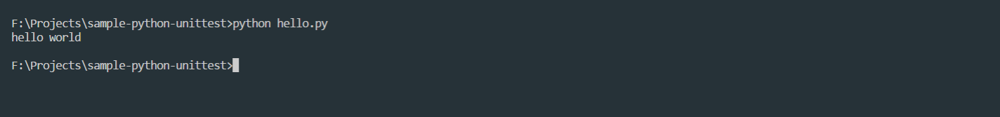

## Unit Test එක් කිරීම

ඉහත folder එක තුලම *test_hello.py* ලෙස වෙනත් ගොනුවක් සාදා මෙය එහි paste කරන්න.

```python
import unittest
import hello

# Initialize a class to use with unittest framework
class HelloTest(unittest.TestCase):

    # Test the hello world function from hello.py
    def testHelloWorld(self):
        # check whether the 'hello world' is returned by the method
        self.assertEqual(hello.helloWorld(), 'hello world')

# run unit test
if __name__ == '__main__':
    unittest.main()
```

දැන් command line එක තුල

```bash
python  -m  unittest
```

ලෙස මෙය run කිරීම කල හැකියි.

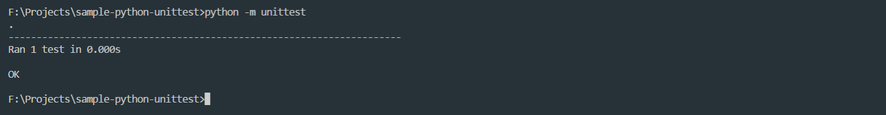

මෙහිදී **assertEqual** මගින්

```python
assertEqual(first,  second)
```

හි first සහ second සමානදැයි එනම් **first == second** ද යන්න බලන එකයි වෙන්නෙ.

දැන් **hello.py** හි *helloWorld()* මෙලෙස වෙනස් කර *python -m unittest* යන්න run කර බලමු.

```python
def helloWorld():
    return 'hello'
```

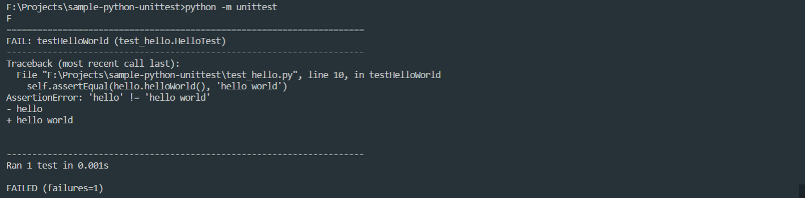

මෙහිදී ඔබට පේනවා ඇති unit test එක fail වූ බව. නැවත

```python
    return 'hello world'
```

ලෙස එය සකසා save කරන්න.

## Git Repository

දැන් මෙම folder එක තුල

```bash
git init
```

ලෙස ටයිප් කල විට මෙම folder එක ඔබගේ **git repository** එකක් ලෙස සලකනු ඇත.

```bash
git add .
git commit -m  "my first commit"
```

මෙමගින් වන්නේ ඔබේ folder එක තුල දැන් ඇති සියළුම වෙනස්කම්, **git** මගින් **track** කරන්න යන්නයි.

දෙවැන්නෙන් දැන් සිදු කල වෙනස **git repository** හි සටහන් කරගැනීම වෙනවා.

> මෙය VCS ගැන සවිස්තර tutorial එකක් නොවේ. එනිසා වැඩිදුර විස්තර කිරීම් නොමැති බව සලකන්න

## GitLab සමග වැඩ අල්ලමු

**GitLab** වෙත පිවිස ඉහල ඇති **+** ලකුණ මගින් **New Project** වෙත යන්න.

එවිට මතුවන තිරයේ **Project Name** සඳහා කැමති නමක් ලබා දී, *visibility level* එක ඔබට කැමති පරිදි තබන්න.

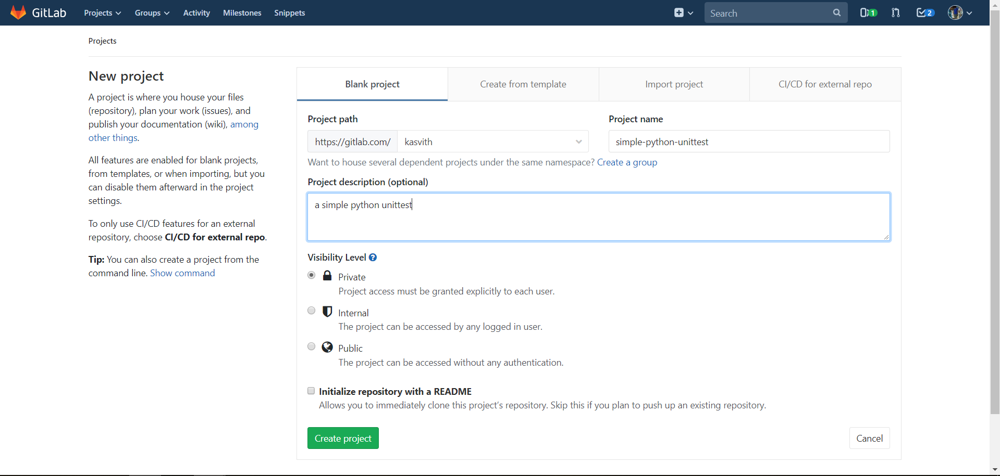

දැන් **Create Project** ලබා දෙන්න. (**Initialize with Readme යන්න සලකුණු කරන්න එපා)**

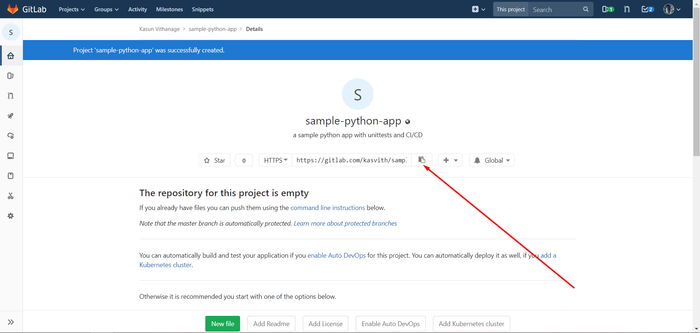

දැන් මෙම දක්වා ඇති button එක මගින් ඔබ නිර්මාණය කල git repository එකේ url එක copy කරගන්න. මෙය **remote repository** එකක් ලෙස ක්‍රියාත්මක වේ.

දැන් ඔබ සිටිනා folder එක වෙත ගොස්

```bash
git remote add origin <paste your url here>
```

ලෙස ඔබගේ **local repo** එකට **remote** එකක් ලෙස එක් කරන්න.

දැන්

```bash
git push -u origin master
```

වලින් ඔබ දැනට සිටිනා branch එකේ තුල ඇති සියළු changes, remote එකට යොමු කරන්න පුලුවන්.

> **සැ.යු. : origin යනු ඔබ ලබාගත් git repo එක හැඳින්වීමට ගන්නා තවත් නමකි.**

දැන් gitlab එක තුල ඔබගේ project එක මෙලෙස දිස්වනු ඇත.

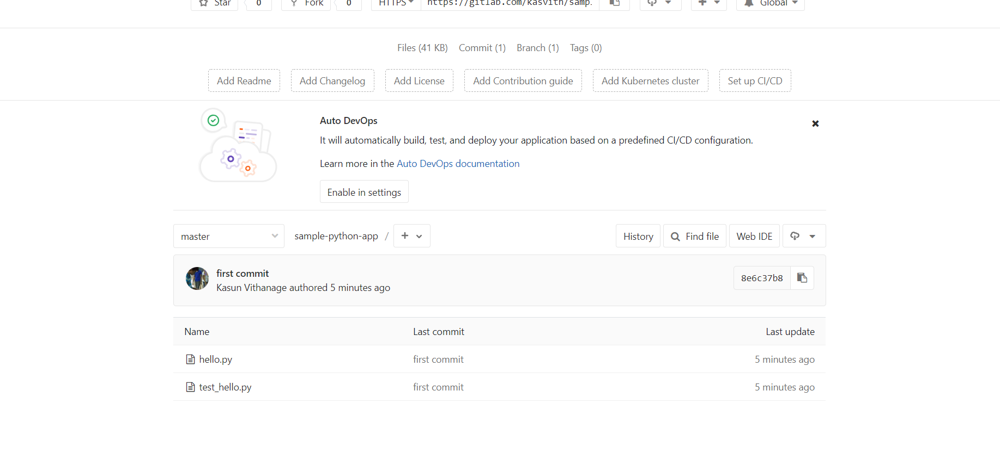

## Continuous Integration(CI)

මෙහිදී සරලව වෙන්නෙ කිසියම් **developer** කෙනෙක් ගෙ **නවතම *code*** **එකක්**, එම අවස්ථාවේ පවතින **working code** එක සමඟ එකතු කර

- එය **build** වෙනවාද
- එය **tests** සමත් වෙනවාද

යන්න නිරන්තරයෙන් අවම මිනිස් මැදිහත්වීමක් යටතේ නිරීක්ෂණය තමා සිදුවන්නෙ.

## Continuous Delivery(CD)

මෙතනදි සරලවම වෙන්නෙ **CI** තුලින් සමත්වන කේතයක් **release** කිරීමයි. මෙය විවිධ **OS** සඳහා විවිධ *file format* වලින් සිදු කල යුත්තක් වන්න පුළුවන්. එම ක්‍රියාව හැකි තරම් **automate** කරන එක තමා මෙතනින් කරන්නෙ.

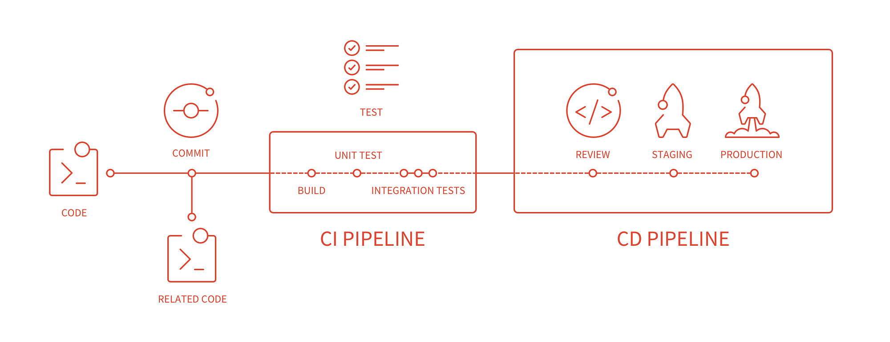

## CI/CD GitLab හරහා

මෙය සඳහා GitLab Repository එකක් තුල **.gitlab-ci.yml** නම් file එකක් අවශ්‍ය වෙනවා.

> **Windows OS** සඳහා **VSCode/Sublime/IntelliJ** වැනි code editor එකක් භාවිතා කිරීමෙන් මෙම **file නිර්මාණයේදී එන ගැටළු** මගහරවාගන්න පහසුවෙන් පුලුවන්

CI සඳහා අපට අවැසි වන්නේ **python unit test** සමත්වීමයි.

**.gitlab-ci.yml**

```yaml
test:
  image: python:3.7
  script:
    - python -m unittest
```

මෙම file එක මගින් **gitlab ට දැනුම් දෙනවා** කිසියම් branch එකකට **push** කරනා විට test කියලා **job** එකක් run කරන්න කියල.

මෙතනදි අපි යොදාගන්නේ python නිසා එයට අවශ්‍ය [**Docker**](https://www.docker.com/) Image එක වන **python 3.7** මෙම අවස්ථාවට යොදාගන්න කියල.

**script** section එකෙන් **අපිට run කරන්න ඕන commands දෙන්න පුලුවන්.**

### බලන් ඉන්නෙ ඇයි ?.

```bash
git add .gitlab-ci.yml
git commit -m  "welcome to ci"
git push origin master
```

දැන් Gitlab Project එක තුල **CI/CD -> Pipelines** වෙත ගොස් බලන්න.

*Running* ලෙස දැක්වෙන්නේ ඔබ දැන් කල test එකයි.

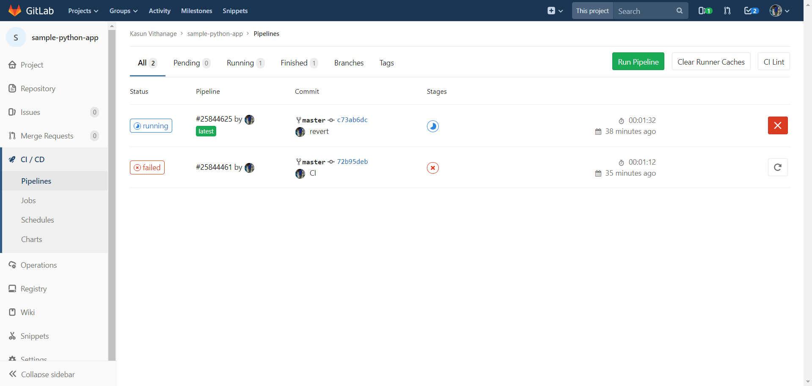

දැන් **status** යටතේ ඇති **latest** මත *click* කරන්න

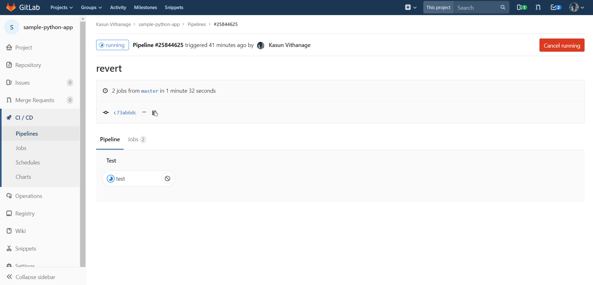

දැන් *Pipeline* යටතේ ඇති *test* යන **stage** එක මත *click* කරන්න. පහත පරිදි ඔබගේ **test** එක සිදුවූ අයුරු දකින්න පුලුවන්.

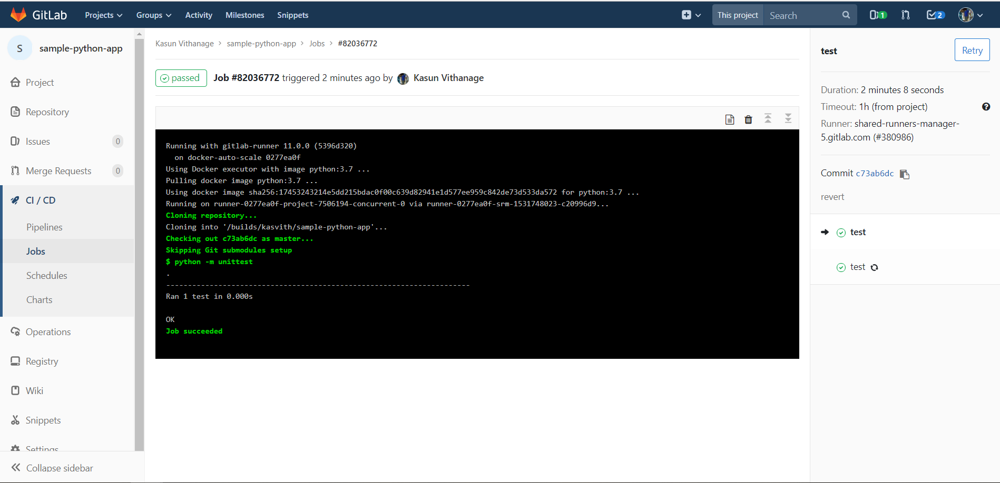

දැන් ඔබ නැවත project tab එකට ගියොත් දකින්න පුලුවන් **commit passed** කියලා.

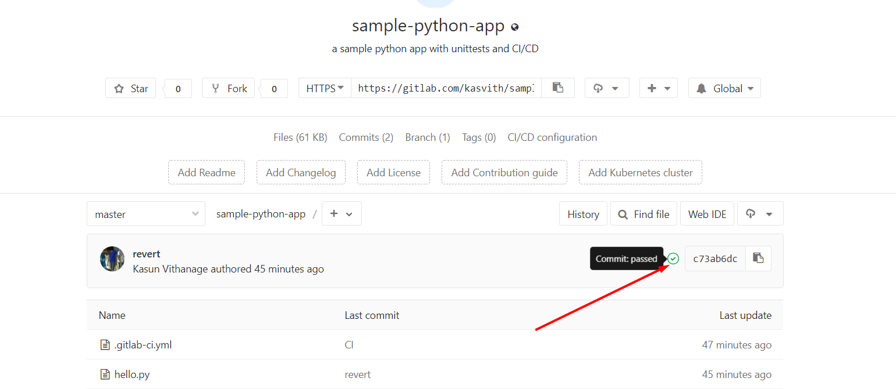

දැන් අපි වෙනත් **branch** එකක් වෙත යමු.

```bash
git checkout -b break-code
```

දැන් *hello.py* හි

```python
def helloWorld():
    return 'hello'
```

ලෙස වෙනස් කරන්න.

දැන් නැවත

```bash
git add hello.py
git commit -m "bye world"
git push origin break-code
```

මෙයින් නවතම *branch* එකකට code එක යනවා. දැන් **pipelines** තුල ඔබට දකින්න පුළුවන් ඔබගේ *branch* එක run වෙනවා.

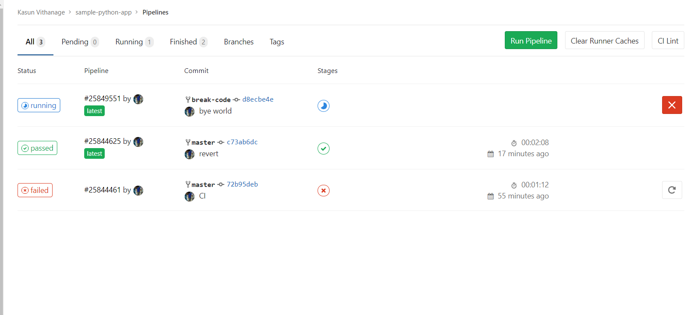

අප කල වෙනස්කම නිසා *test* එක **fail** වන බව දකින්න පුලුවන්.

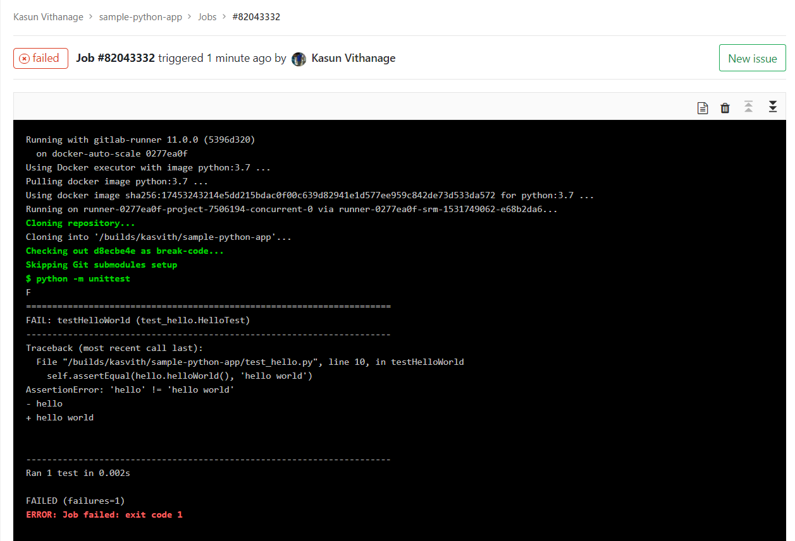

දැන් **Merge Request** වෙත ගොස් අදාල *branch* එක තුල ඇති **Create Merge Reques**t යන්න *click* කරන්න.

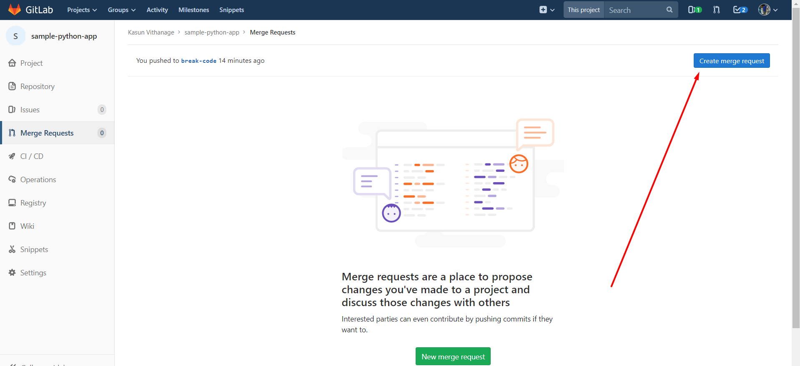

අදාල මාතෘකාවක් සහ විස්තරයක් ලබාදී

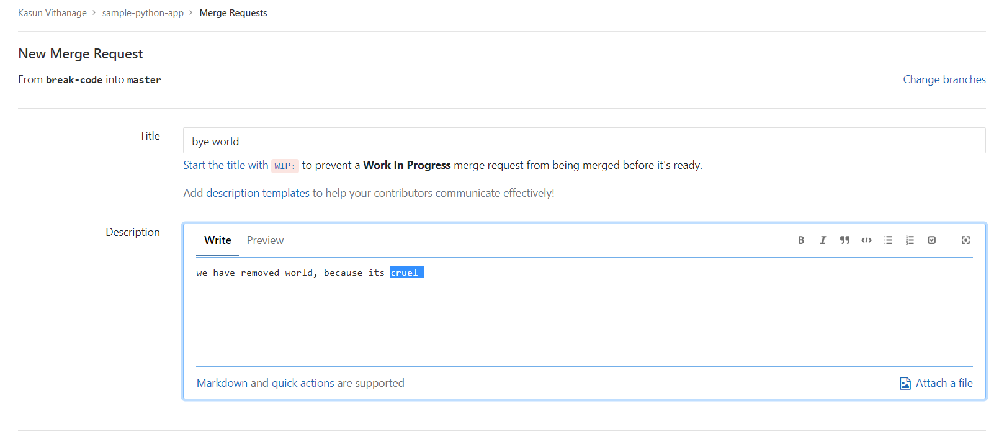

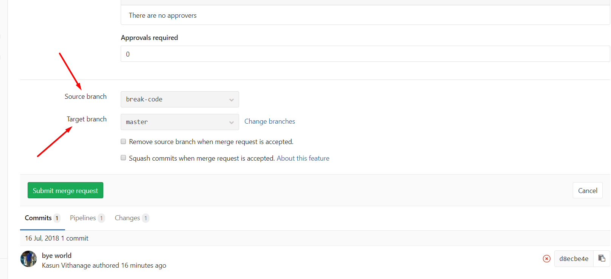

දැන් අදාල **source** සහ **target (***master***)** තෝරා **Submit Merge Request** ලබාදෙන්න.

එයින් වෙන්නේ ඔබේ *break-code* යන *branch* එක **master** සමග එක් කරන එක.

එවිට පහත පරිදි **pipeline fail** වූ බවත්, **එය merge කිරීම අනතුරුදායක බවත් gitlab ඔබට දන්වා සිටිනව**.

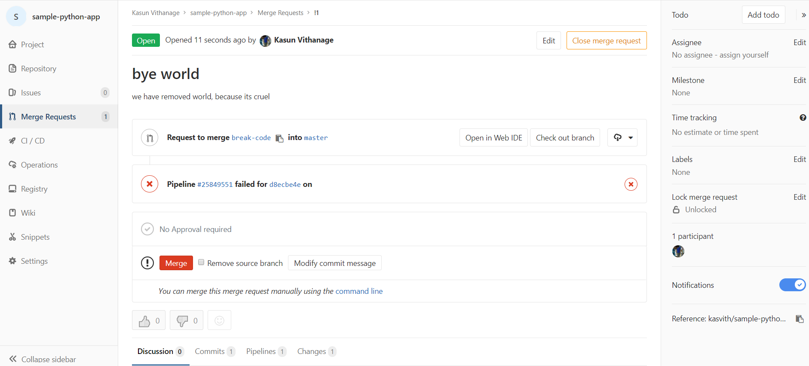

එනම් මෙම code එක **master** තුල ඇති **වැඩකරනා** program එක **ඔබට අවශ්‍ය ලෙස වැඩ නොකරන තත්වයට** ගෙන එනවා.

**Close Merge Request** *click* කරන්න.

නැවත command line හිදී

```bash
git checkout master
```

තුලින් අප **master branch** එකට යමු.

## Continuous Delivery

දැන් අපට ඕන වෙන්නෙ මෙම **master branch** එකට යමෙක් **push** කල විට හෝ කෙනෙක්ගෙ **Merge Request(Pull Request)** එකක් **merge** වූ විට එම නවතම code එක zip සහ tar ලෙස ලබාගන්න හෝ *Amazon S3, firebase, Heroku, Github Releases, Docker Registry* වැනි ස්ථානයකට ලබා දීම.

මෙයට *.gitlab-ci.yml* තුල මේ වෙනස්කම කරන්න.

Ready for Release

```yaml
test:
  image: python:3.7
  script:
    - python -m unittest

production:
  script:
    - tar -czvf release.tar.gz *.py
```

මෙහි ඔබට දකින්න පුළුවන් **test** හා **production** ලෙස **jobs** දෙකක් ඇති බව.

මෙහි *production* හි **script** එක ලෙස අප ලබාදී තිබෙන්නෙ **current directory** එකේ තිබෙන සියලුම *python files* , **.tar.gz** ලෙස **compress** කරන්න කියල. ඒ ගැන වැඩිදුර [මෙතනින්](https://www.howtogeek.com/248780/how-to-compress-and-extract-files-using-the-tar-command-on-linux/) දැනගන්න. අප දැන් සිටින්නේ **Linux Environment** එකක් තුලයි.

මෙය *master* වලට *push* කර *pipelines* බැලූවිට මෙසේ දකින්න පුලුවන්

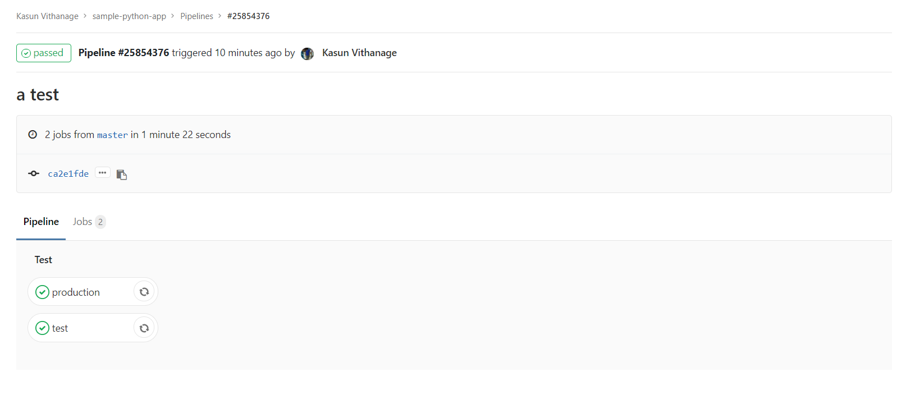

නමුත් ඔබ දකින්න ඇති *production* තුලට ගොස් බැලුවොත් ඔබේ *release.tar.gz* එක නොමැති බව. අප **GitLab CI** ට දැනුම් දෙන්න ඕන මේ හදන archive එක පසු භාවිතය සඳහා තියාගන්න ඕන කියල.

**තවත් ප්‍රශ්නයක් තමා test එක fail උනත් production run වීම.** මේක නොවියයුතු යමක්. **එනම් test එකෙන් පසුව තමා production එක වෙන්න ඕන**.

තවදුරටත්, අපිට **production stage එක run විය යුත්තේ** **master branch එකට push කලොත් පමණයි**. අනෙක් අවස්ථාවලදී අපට එහෙම දෙයක් ඕන නෑ.

ඒ සඳහා පහත ලෙස *.gitlab-ci.yml* වෙනස් කරන්න

Improved CI/CD

```yaml
stages:
  - test
  - production

test:
  stage: test
  image: python:3.7
  script:
    - python -m unittest

production:
  stage: production
  script:
    - tar -czvf release.tar.gz *.py
  artifacts:
    paths:
      - release.tar.gz
  only:
    - master
```

මෙහි **stages** යනු *jobs* එකින් එක සිදු විය යුතු ආකාරයයි. එනම් *test* වලින් පසුව *production* ලෙස යන්නයි.

සෑම **sequence** ලෙස run වෙන්න ඕන *job* සඳහාම අපි stage එක define කරලා තියනවා(*Line 6, 12*)

**artifacts** වලින් අදාල path එක තුල ඇති file හෝ directory එක [**Gitlab CI Runner**](https://docs.gitlab.com/runner/) විසින් සුරැකීම කරනවා.

**only** තුලින් අපට මෙය **master branch** එකට(හෝ අවශ්‍ය වෙනත් branch එකකට) **push** කරනා විට පමණක් ක්‍රියාත්මක වන්න සකසන්න පුළුවන්. (*ඔබ Merge Request/Pull Request* ***merge*** *කරනා විටද මෙය වෙනවා, එහිදී* ***gitlab*** *විසින් master branch එකට push කිරීම සිදු කරයි.*)

දැන් ඉහත *.gitlab-ci.yml* **push** කර *pipeline* දෙස බලන්න…...

සියළු pipeline අවසානයේදී මෙලෙස ඔබේ **artifacts download** කරගත හැකියි.

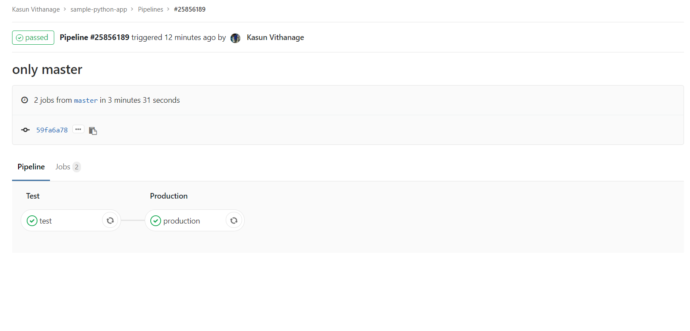

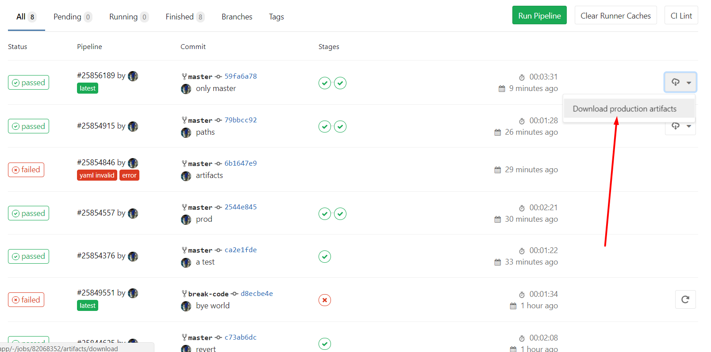

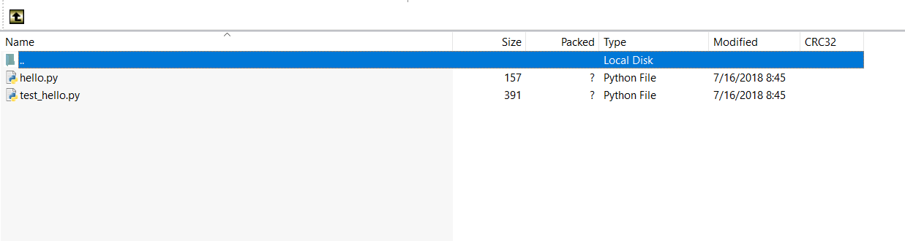

**දැන් අපට මෙහි දකින්න පුළුවන් අප සකස් කල ලෙසම release.tar.gz නිර්මාණය වී ඇති බව.**

---

## සටහන

> ඉතාම දිගු tutorial එකක් ලෙස මෙය ලියන්න වුනේ **VCS** වැනි tools ගැන **බොහෝමයක් නොදන්නා නිසයි**.

> සංකීර්ණ බව අවම කිරීම පිණිස සරල මට්ටමේ CI/CD මූලිකව මෙහි දක්වා තිබෙනව.

> **GitLab CI** පමණක් නොව, [***Travis CI***](https://travis-ci.org/)**,** [***Circle CI***](https://circleci.com/)**,** [***Drone CI***](https://drone.io/)**,** [***Jenkins***](https://jenkins.io/)**(*automated server*)** වැනි තවත් බොහෝ සේවාවන් පවතිනවා.

> බොහොමයක ක්‍රියාපටිපාටිය සිදුවන්නෙ මේ ආකාරයටයි. ඒවාගෙ documentation කියවා ඉදිරියට යන්න ඔබට හැකියි.

---


### මේ අනුව වඩාත් හොඳින් Software Systems නිර්මාණය කිරීමට ඔබට හොඳ අත්වැලක් ලැබුණායයි සිතනවා :)

Code : [https://gitlab.com/kasvith/sample-python-app](https://gitlab.com/kasvith/sample-python-app)
