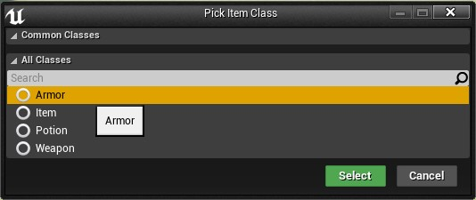
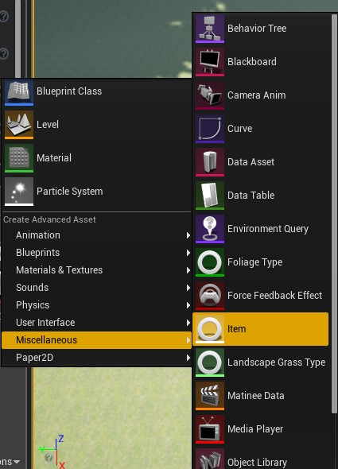
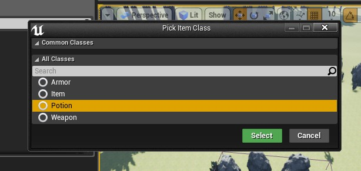
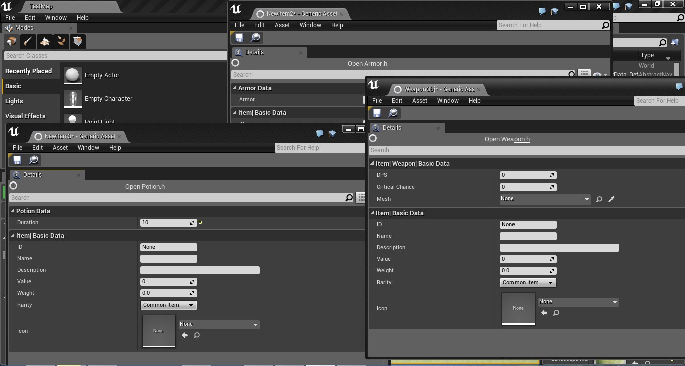

In most game projects you need somewhere to keep data. Unreal Engine 4 gives you a few options, like Data Assets and Data Tables.

Sometimes, though, you want a content browser asset that just holds data, like an item in the game world with its own properties.

As a programmer, you also want designers (and yourself) to create those assets quickly in the Unreal Editor, the same way you pick Data Asset from the content browser's context menu. It prevents a lot of mistakes. The usual alternative is a “Master Item” Blueprint that you make a child of every time you need a new item, and with many items that gets messy fast. While working on [Lunar Saga: Elemental Clash](http://www.indiedb.com/games/lunar-saga-elemental-clash), I wanted to keep the editor clean and tidy, and to create assets for items, weapons and potions quickly.

So I built a custom class picker, like the one the Unreal Editor shows for Data Assets. Here's how it looks at the end:



I'll assume you know the basics of Unreal C++. If not, there are plenty of good tutorials out there.

## Create a custom content browser asset

First we'll make a custom asset type for the content browser. This is better than creating a master Blueprint and inheriting from it, and because it's C++ you can automate things too.

### The Item class

Start with a simple parent class called Item. In the editor, create a new C++ class, turn on “Show all classes” and choose Object as the parent class. Name it Item, then open Item.h and add this after the includes (`MYPROJECT_API` changes with your project name):

```cpp
UCLASS(BlueprintType)
class MYPROJECT_API UItem : public UObject
{
    GENERATED_UCLASS_BODY()
public:
    UPROPERTY(EditAnywhere, BlueprintReadWrite, Category=Item)
    FString Name;
};
```

This class just holds data for testing. `BlueprintType` lets you create Item variables in Blueprints.

### A factory for the content browser

Next, let the content browser create Items. In the Unreal Editor, create another C++ class, this time with Factory as the parent, and name it `ItemFactory`. Open ItemFactory.h in Visual Studio and add this after the includes:

```cpp
UCLASS()
class MYPROJECT_API UItemFactory : public UFactory
{
    GENERATED_UCLASS_BODY()

    virtual UObject* FactoryCreateNew(UClass* InClass, UObject* InParent, FName InName, EObjectFlags Flags, UObject* Context, FFeedbackContext* Warn) override;
};
```

The Unreal Editor calls `FactoryCreateNew` when it creates a new object in the content browser.

Now open ItemFactory.cpp. Between these two lines:

```cpp
#include "MyProject.h"
#include "ItemFactory.h"
```

insert this, so the factory can see the Item class:

```cpp
#include "Item.h"
```

Then add the implementation below:

```cpp
#define LOCTEXT_NAMESPACE "Item"

UItemFactory::UItemFactory(const FObjectInitializer& ObjectInitializer) : Super(ObjectInitializer)
{
    bCreateNew = true;
    bEditAfterNew = true;
    SupportedClass = UItem::StaticClass();
}

UObject* UItemFactory::FactoryCreateNew(UClass* InClass, UObject* InParent, FName InName, EObjectFlags Flags, UObject* Context, FFeedbackContext* Warn)
{
    return NewObject<UItem>(InParent, InClass, InName, Flags | RF_Transactional);
}

#undef LOCTEXT_NAMESPACE
```

The constructor sets the class this factory supports, `UItem`, through its `StaticClass()`. `FactoryCreateNew` returns a new `UItem` to the editor, and the `RF_Transactional` flag makes the new object transactional.

### Try it in the editor

Save everything, go back to the editor and compile. Now open the content browser's context menu, go to Miscellaneous, choose Item and create one:



## Add a class picker for Item subclasses

That works, but there's a new problem: every time you create a class that inherits from Item, you'd need another factory, and the editor becomes a mess again. We can fix that with a class picker dialog.

### Add the editor modules

This code needs access to the Unreal Editor. Open MyProject.Build.cs and add the `UnrealEd` and `ClassViewer` modules to the dependencies, so the first line looks like this:

```csharp
PublicDependencyModuleNames.AddRange(new string[] { "Core", "CoreUObject", "Engine", "InputCore", "UnrealEd", "ClassViewer" });
```

### Update the factory header

Next, change ItemFactory.h to this:

```cpp
#pragma once

#include "UnrealEd.h"
#include "Editor/ClassViewer/Public/ClassViewerModule.h"
#include "Editor/ClassViewer/Public/ClassViewerFilter.h"
#include "Factories/Factory.h"
#include "ItemFactory.generated.h"

/**
*
*/
UCLASS()
class MYPROJECT_API UItemFactory : public UFactory
{
    GENERATED_UCLASS_BODY()

    UPROPERTY(EditAnywhere, Category = Item)
    TSubclassOf<UItem> ItemClass;

    virtual UObject* FactoryCreateNew(UClass* InClass, UObject* InParent, FName InName, EObjectFlags Flags, UObject* Context, FFeedbackContext* Warn) override;
    virtual bool ConfigureProperties() override;

};

class FItemFilterViewer : public IClassViewerFilter
{
public:
    TSet<const UClass*> AllowedChildrenOfClasses;
    uint32 DisallowedClassFlags;

    virtual bool IsClassAllowed(const FClassViewerInitializationOptions& InInitOptions, const UClass* InClass, TSharedRef< class FClassViewerFilterFuncs > InFilterFuncs) override
    {
        return !InClass->HasAnyClassFlags(DisallowedClassFlags)
            && InFilterFuncs->IfInChildOfClassesSet(AllowedChildrenOfClasses, InClass) != EFilterReturn::Failed;
    }

    virtual bool IsUnloadedClassAllowed(const FClassViewerInitializationOptions& InInitOptions, const TSharedRef< const IUnloadedBlueprintData > InUnloadedClassData, TSharedRef< FClassViewerFilterFuncs > InFilterFuncs) override
    {
        return !InUnloadedClassData->HasAnyClassFlags(DisallowedClassFlags)
            && InFilterFuncs->IfInChildOfClassesSet(AllowedChildrenOfClasses, InUnloadedClassData) != EFilterReturn::Failed;
    }
};
```

`ItemClass` holds the class you pick, and `FItemFilterViewer` decides which classes show up in the picker.

### Show the picker when creating an asset

Then update ItemFactory.cpp:

```cpp
#include "MyProject.h"
#include "UnrealEd.h"
#include "Item.h"
#include "Editor/ClassViewer/Public/ClassViewerModule.h"
#include "Editor/ClassViewer/Public/ClassViewerFilter.h"
#include "Editor/UnrealEd/Public/Kismet2/SClassPickerDialog.h"
#include "ItemFactory.h"

#define LOCTEXT_NAMESPACE "Item"

UItemFactory::UItemFactory(const FObjectInitializer& ObjectInitializer) : Super(ObjectInitializer)
{
    bCreateNew = true;
    bEditAfterNew = true;
    SupportedClass = UItem::StaticClass();
}

UObject* UItemFactory::FactoryCreateNew(UClass* InClass, UObject* InParent, FName InName, EObjectFlags Flags, UObject* Context, FFeedbackContext* Warn)
{
    if (ItemClass != nullptr)
    {
        return NewObject<UItem>(InParent, ItemClass, InName, Flags | RF_Transactional);
    }
    else
    {
        check(InClass->IsChildOf(UItem::StaticClass()));
        return NewObject<UItem>(InParent, InClass, InName, Flags | RF_Transactional);
    }
}

bool UItemFactory::ConfigureProperties()
{
    ItemClass = nullptr;

    FClassViewerModule& ClassViewerModule = FModuleManager::LoadModuleChecked<FClassViewerModule>("ClassViewer");
    FClassViewerInitializationOptions Options;
    Options.Mode = EClassViewerMode::ClassPicker;

    TSharedPtr<FItemFilterViewer> Filter = MakeShareable<FItemFilterViewer>(new FItemFilterViewer);
    Options.ClassFilter = Filter;

    Filter->DisallowedClassFlags = CLASS_Abstract | CLASS_Deprecated;
    Filter->AllowedChildrenOfClasses.Add(UItem::StaticClass());

    const FText TitleText = LOCTEXT("CreateItemOptions", "Pick Item Class");
    UClass* ChosenClass = nullptr;
    const bool bPressedOk = SClassPickerDialog::PickClass(TitleText, Options, ChosenClass, UItem::StaticClass());

    if (bPressedOk)
    {
        ItemClass = ChosenClass;
    }

    return bPressedOk;
}

#undef LOCTEXT_NAMESPACE
```

## How the picker works

`ConfigureProperties` runs before the asset is created. It first resets `ItemClass` to `nullptr`, so every new asset starts fresh.

It then loads the ClassViewer module through the module manager and sets the Class Viewer's mode to `ClassPicker`, one of the `EClassViewerMode` values. Next it creates our filter as a shared pointer with `MakeShareable`. If you know C++ well, you'll know a shared pointer is a type-safe smart pointer. Then it sets that filter on the Class Viewer options.

```cpp
Filter->DisallowedClassFlags = CLASS_Abstract | CLASS_Deprecated;
```

This stops you from picking abstract or deprecated classes. See ObjectBase.h for the other class flags.

```cpp
Filter->AllowedChildrenOfClasses.Add(UItem::StaticClass());
```

This one is important: it allows Item and all of its child classes, unless they're marked abstract.

Because we defined `LOCTEXT_NAMESPACE`, the `LOCTEXT` title goes through Unreal's localization system, and “Pick Item Class” shows as the dialog's title. Finally, `SClassPickerDialog::PickClass` opens the dialog with our filter and returns whether you pressed Select. If you did, `ItemClass` is set to the chosen class, and the editor moves on to `FactoryCreateNew`.

`FactoryCreateNew` checks whether `ItemClass` is set. If it is, it creates an object of the selected Item class or subclass. If something went wrong and it isn't, it falls back to the class it was given:

```cpp
check(InClass->IsChildOf(UItem::StaticClass()));
```

This assertion stops execution if that class isn't an Item, so `NewObject` doesn't go mad and do crazy things.

## The result

That was a bit long, but we're done. Don't forget to add a few classes that inherit from Item, such as Potion, using the editor. Then here's the final result:





This was my first blog post, and I did my best to make something useful, so feedback is welcome. If I made any mistakes, I'd like to know.

I hope this helps you start tweaking the Unreal Editor. Good luck!
