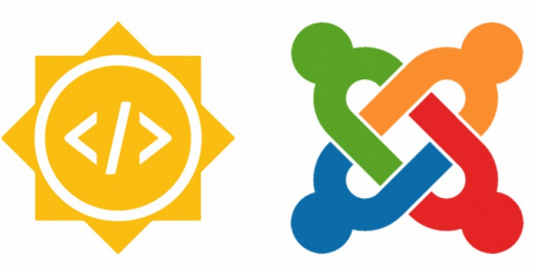
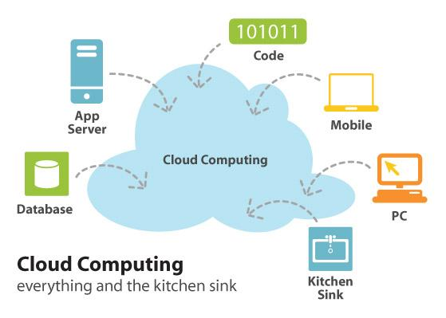
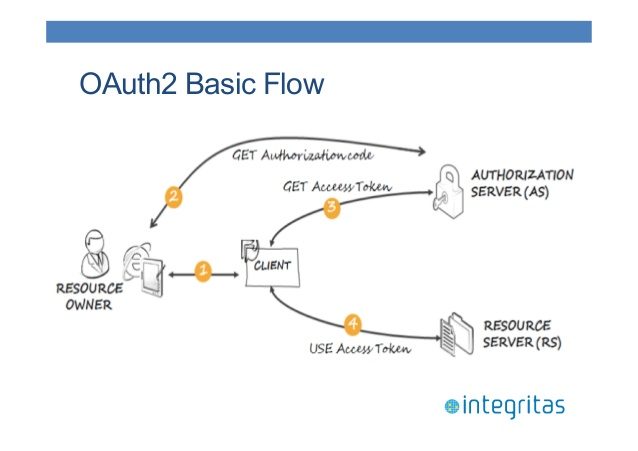

**Joomla!** is an open source content management system (CMS) for building websites and powerful web applications. Thanks to its performance and usability, millions of websites run on Joomla. A big advantage of a CMS like Joomla is that you don't need technical skills to manage your site. Joomla keeps track of every piece of content on your website, whether it's text, photos, videos, music, documents or anything else you can think of.

## Cloud services

Cloud services make it easy for people to collaborate, and they give users a lot of space for their files. Most of them provide APIs that let third-party developers build services on top of them, so users get a premium experience at a lower cost.

## Why a cloud file system for Joomla!?

People who run blogs often need to store images and share them with others, and clouds are a safe place for all of that. Over time a user may need more storage than their hosting plan gives them, which gets costly. Integrating cloud services into **Joomla!** solves that.

Users will be able to keep large files in a third-party cloud and use them like ordinary files in Joomla!.

## The project

The project is to build a rich **API** that lets third-party extension developers add a cloud file system to Joomla!.

**OAuth 2.0** is the preferred way to access information stored in a cloud.

Users get tokens from their cloud service. Access tokens are short-lived, while refresh tokens last much longer, so Joomla! uses the refresh token to get new access tokens when it fetches content. The **API** built in this project will serve media from cloud services using **OAuth2**.
