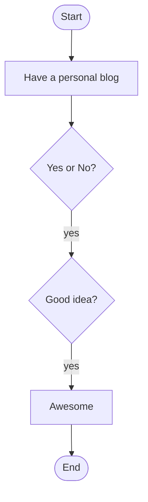

I decided to pull off all my blogs to a personal space ⚡️

## Why moving to own space

It's been a while I started blogging. I started from [Blogger](https://www.blogger.com/), [Wordpress](https://wordpress.com/) and finally stopped over [Medium](https://medium.com). It was fine to use these awesome tools. But with the time I felt that moving to my own space is better for blogging.

While these platform provides a great service I wanted more control over my content. I hate ads and stuffs, paywalls and I know you do too. All these contents are writing for free so you need to have access with zero distractions 😄

## What was your next step

Github provides free static site hosting since few years. So I decided to try it out since it gives much more flexibility over my content. Its hosted as plain html/css/js files so there is no dedicated backend for this too. There were several popular static site generators when I decided to move on

- Jekyll - GitHub directly supports hosting jekyll sites, but its based on ruby and doesn't work well in Windows
- Gatsby - Seems fine but it uses React 😄
- Hugo - Powered by Go, super fast(I mean lightning fast) and very easy to customize(I've a good background in go so its a +1)

So as you can see I've picked up [Hugo](https://gohugo.io/) ❤️

Since Hugo is powered by Go I can easily work in Windows too, it is very easy to get it running compared to others I tried. Has bunch of options and really loving it.

These static site generators are using Markdown to write the contents. As a programmer I really love working with Markdown rather than a WYSIWYG 😄.

Also I can easily add **flowcharts** to my posts like this.

All with simple markdown.

Editing becomes simple, no databases, content is easy to manage and flexible.

Also no need to have ill syntax highlighters from other previous options, no need to have uncountable **gists** for just an one article.

So there are lot of benefits moving to the personal space giving me 😄

## Next steps

I will move all my content over here with time. Thank you.
