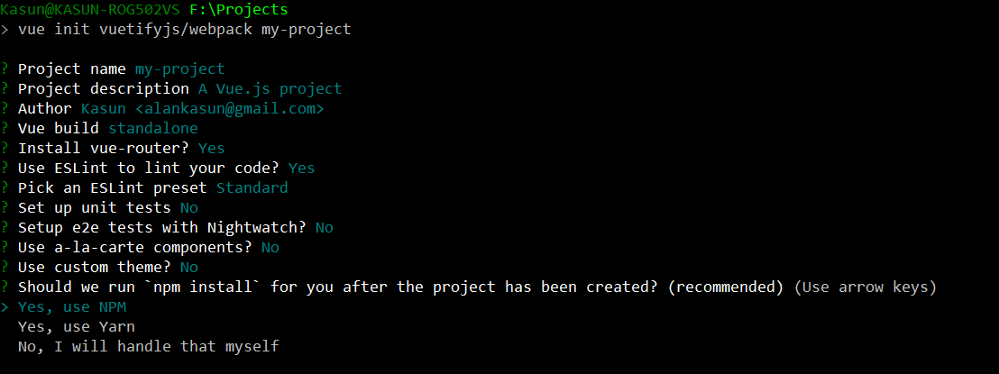
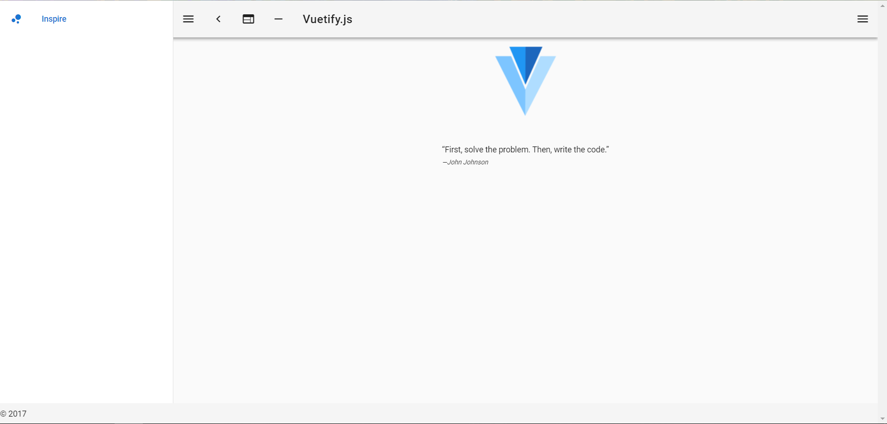
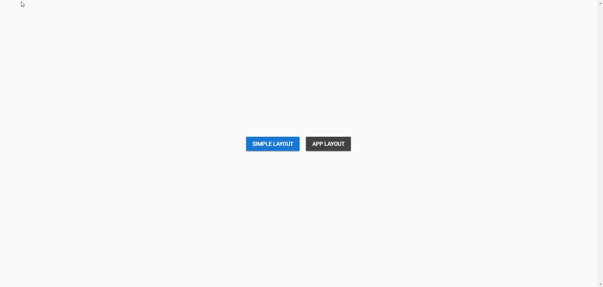

It is a common problem that even a **Single Page App** needs **Multiple Layouts** to display views. For example, a Login Page may not require unnecessary toolbars etc.

Today I’m going to show you how I overcome this with **VueJS**. For this tutorial, I will assume you have knowledge on **VueJS, VueRouter,** and **Vuex** . We are going to use [**VuetifyJS**](https://vuetifyjs.com) for style our application and for easy setup. You can use any other style guide with this method though.

## Lets Start

First install **vue-cli** and start a fresh SPA project using Vuetify Template.

> For non-vuetify projects, the procedure is same.

```bash
npm install -g vue-cli
vue init vuetifyjs/webpack my-project
cd my-project
npm install
npm run dev
```



These commands will start the ***webpack development server*** on your machine. For simplicity we ignore setting up the testing part.

Now you will see this on your browser



Now install [Vuex](https://vuex.vuejs.org/en/) using

```bash
npm install --save vuex
```

## Dynamic Components

**VueJS** is awesome. It has almost everything you need. For our task we target using [dynamic components](https://vuejs.org/v2/guide/components.html#Dynamic-Components).

**VueJS allows you to switch between components dynamically using same element**.

## Your Layouts

Before we start, we need to have some layouts. We are going to create two of them.

- Simple: A simple layout as its name implies
- App: Application layout with a fancy sidebar and a toolbar

Go ahead and create a folder **src/layouts** and add those two files in it

**src/layouts/SimpleLayout.vue**

```vue
<template>
    <router-view></router-view>
</template>

<script>
export default {

}
</script>
```

`src/layouts/AppLayout.vue` (It may look complex, but it is up to you put the router-view where you want)

```vue
<template>
  <v-app id="inspire">
    <v-navigation-drawer
      fixed
      v-model="drawer"
      app
    >
      <v-list dense>
        <v-list-tile>
          <v-list-tile-action>
            <v-icon>home</v-icon>
          </v-list-tile-action>
          <v-list-tile-content>
            <v-list-tile-title>Home</v-list-tile-title>
          </v-list-tile-content>
        </v-list-tile>
        <v-list-tile>
          <v-list-tile-action>
            <v-icon>contact_mail</v-icon>
          </v-list-tile-action>
          <v-list-tile-content>
            <v-list-tile-title>Contact</v-list-tile-title>
          </v-list-tile-content>
        </v-list-tile>
      </v-list>
    </v-navigation-drawer>
    <v-toolbar color="indigo" dark fixed app>
      <v-toolbar-side-icon @click.stop="drawer = !drawer"></v-toolbar-side-icon>
      <v-toolbar-title>Application</v-toolbar-title>
    </v-toolbar>
    <v-content>
      <v-container fluid fill-height>
        <router-view></router-view>
      </v-container>
    </v-content>
    <v-footer color="indigo" app>
      <span class="white--text">&copy; Its your app</span>
    </v-footer>
  </v-app>
</template>

<script>
  export default {
    data: () => ({
      drawer: null
    }),
    props: {
      source: String
    }
  }
</script>
```

So in both files, you can see that I’ve put a `<router-view></router-view>` element. This is used by **VueRouter** to display a router view on the application.

Now we have two different layouts. For example to display a login page **SimpleLayout** can be used.

## Keep application state with Vuex

Since our application will be complex, we will use Vuex here to manage the state of the application.

Create **src/store/index.js** and add the following inside

```javascript
'use strict'

import Vue from 'vue'
import Vuex from 'vuex'

Vue.use(Vuex)

export const store = new Vuex.Store({
  state: {
    layout: 'simple-layout'
  },
  mutations: {
    SET_LAYOUT (state, payload) {
      state.layout = payload
    }
  },
  getters: {
    layout (state) {
      return state.layout
    }
  }
})
```

This is a very simple Vuex Store that used to hold the the state of the application. Here you can see there is a state variable for **layout** and it’s set to **simple-layout**. This is the name of the layout, we will define it soon in our application.

We have set a mutation called **SET_LAYOUT** for changing the state of the layout state. As you know in Vuex, the only way to change a state is a commit using a mutation.

Also we have defined a getter called **layout** to get the state out of this variable.

## Show your layouts

Now you need a way to show your desired layouts. We have two of them and we now also have a Vuex store to keep track of the current layout in the application.

For this open **src/App.vue** and add the following

```vue
<template>
  <v-app>
    <component v-bind:is="layout"></component>
  </v-app>
</template>

<script>
import AppLayout from './layouts/AppLayout'
import SimpleLayout from './layouts/SimpleLayout'

export default {
  computed: {
    layout () {
      return this.$store.getters.layout
    }
  },
  components: {
    'app-layout': AppLayout,
    'simple-layout': SimpleLayout
    // define as many layouts you want for the application
  }
}
</script>
```

In here we have imported our layouts and **put them under the components section** in the script. We also have given a name for each component. As you can see in **store** we have used *simple-layout* as default and it refers to the component here.

We have a computed property also called layout. This computed property getting it’s value from the vuex store.

As computed property changes are causing UI updates, when the value in store changes it will also do necessary UI updates in this component.

Most important one here is the

```vue
<component v-bind:is="layout"></component>
```

This is a **dynamic component** in vue. It binds to a component in runtime and switch between components using the same element.

As you can see it was bound to the layout computed property. So once the store updates its value, it will also be passed to `v-bind:is`. Now this will bind the passed component inside the tags.

## Time to test

It’s time to test our application. Before that, we need a Testing component. Go to **src/components** and create a new file called **MyComponent.vue** and add following simple content

```vue
<template>
  <v-container fluid fill-height>
    <v-layout align-center justify-center>
      <v-btn color="primary" @click="setLayout('simple-layout')">Simple Layout</v-btn>
      <v-btn color="secondary" @click="setLayout('app-layout')">App Layout</v-btn>
    </v-layout>
  </v-container>
</template>

<script>
export default {
  methods: {
    setLayout (layout) {
      this.$store.commit('SET_LAYOUT', layout)
    }
  }
}
</script>
```

In the following simple file we have created two buttons to switch between layouts and a method called `setLayout` for changing the layout.

`setLayout` is a simple method that does a commit to the store changing the layout value on the store.

As we know this will trigger computed property in `App.vue` to change its layout value in the dynamic component

Finally open your **router/index.js** and import this component like this

Sample router file **src/router/index.js**

```javascript
import Vue from 'vue'
import Router from 'vue-router'
import MyComponent from '@/components/MyComponent'

Vue.use(Router)

export default new Router({
  routes: [
    {
      path: '/',
      name: 'MyComponent',
      component: MyComponent
    }
  ]
})
```

This simply mounts the `MyComponent` in the root.

In your `main.js` there is one thing left to do, import and use your store there

**src/main.js**

```javascript
import Vue from 'vue'
import App from './App'
import router from './router'
import Vuetify from 'vuetify'
import 'vuetify/dist/vuetify.min.css'
import { store } from './store'

Vue.use(Vuetify)

Vue.config.productionTip = false

/* eslint-disable no-new */
new Vue({
  el: '#app',
  router,
  store,
  components: { App },
  template: '<App/>'
})
```

This is the entry point your application and now your store is registered.

Save all the files and check your browser



## Conclusion

Here I’ve given you a full application implementation using **VuetifyJS** and using **Vuex**. Vuex was used to show you how to utilize this technique throughout the entire application, so you can change your layouts anywhere and anytime in your application.

Besides that, the concept is simple. It is all dynamic components. That’s all. When coupled with Vuex, we can craft the dream app we want with as many as layouts as needed, not limiting to default one.

**Now you can make your SPA application with multiple layouts same time**

You can get code [here](https://github.com/kasvith/vue-spa-multiple-layouts-example)
