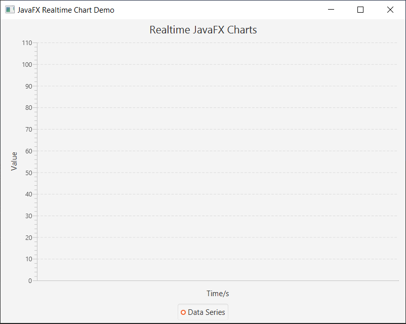
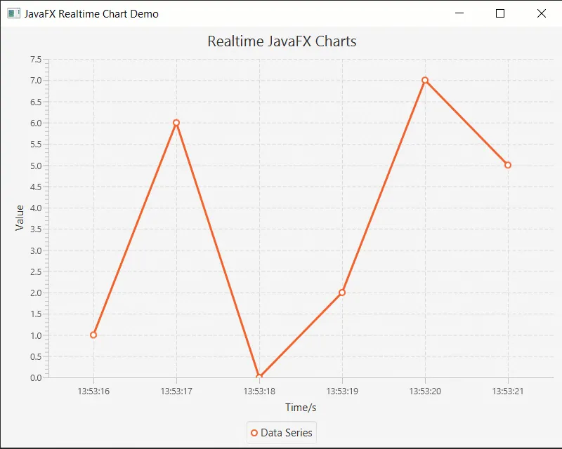
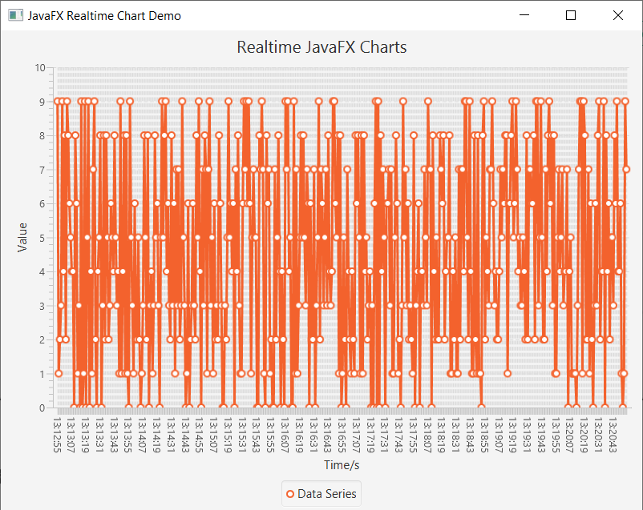
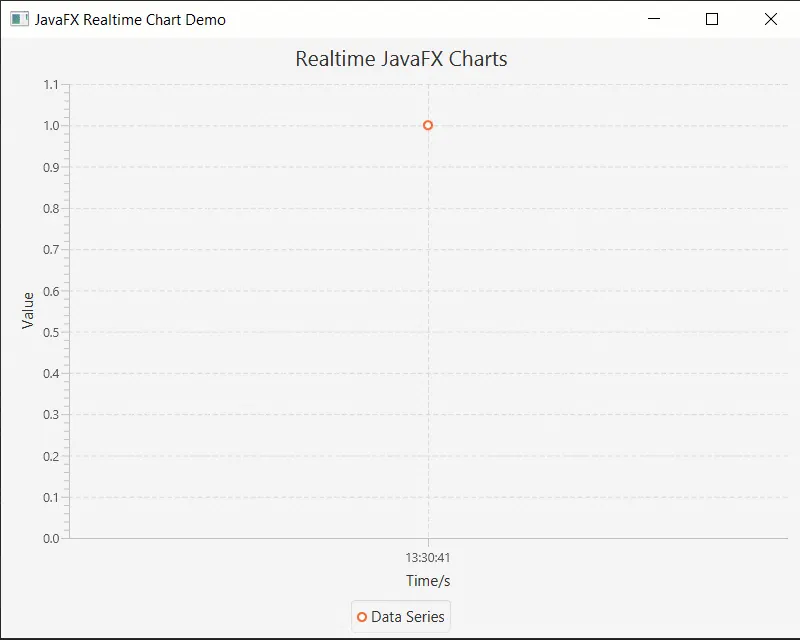

Developing a real-time chart with **JavaFX** is very easy. You just need to know a few things. Let’s get started.

## Bootstrapping the app

First we need to create a **JavaFX** application as usual. We’re not gonna use any fancy controllers here as it will increase the complexity of the tutorial, but you can easily get the concept here.

Simple JavaFX application which shows the title

```java
public class App extends Application {
    public static void main(String[] args) {
        launch(args);
    }

    @Override
    public void start(Stage primaryStage) throws Exception {
        primaryStage.setTitle("JavaFX Realtime Chart Demo");

        // show the stage
        primaryStage.show();
    }
}
```

## Adding the Chart

Next we are going to add axes and chart to display data. To keep this simple I will use the chart itself as the scene.

Add line chart along with axes

```java
        //defining the axes
        final CategoryAxis xAxis = new CategoryAxis(); // we are gonna plot against time
        final NumberAxis yAxis = new NumberAxis();
        xAxis.setLabel("Time/s");
        xAxis.setAnimated(false); // axis animations are removed
        yAxis.setLabel("Value");
        yAxis.setAnimated(false); // axis animations are removed

        //creating the line chart with two axis created above
        final LineChart<String, Number> lineChart = new LineChart<>(xAxis, yAxis);
        lineChart.setTitle("Realtime JavaFX Charts");
        lineChart.setAnimated(false); // disable animations
```

We have now created two axes

- **Category** — This axis can display string data
- **Number** — This axis can display numbers including int, double etc

After setting labels of axes we have disabled **animations** on them. You can *enable* them if you want.

Next we have created a line chart. You are not limited to line charts of course, use whatever pleases you.

Line chart is created targeting two data types. String and Number which exactly what our X-Axis and Y-Axis also holds. Next we also have disabled animations.

## XYSeries to display data

Next we want to show data on the chart. To do so we need a series. **XYSeries** is backing an [**ObservableList**](https://docs.oracle.com/javase/8/javafx/api/javafx/collections/ObservableList.html) as the underlying data structure. Which allows listeners to listen changes of data.

For example when you add a new point to the series the chart will listen to that and draw the point on screen.

A simple series which can hold a string as X-Axis and a Number as Y-Axis

```java
        //defining a series to display data
        XYChart.Series<String, Number> series = new XYChart.Series<>();
        series.setName("Data Series");

        // add series to chart
        lineChart.getData().add(series);
```

## It’s show time

Setup and show the scene

```java
        // setup scene
        Scene scene = new Scene(lineChart, 800, 600);
        primaryStage.setScene(scene);
```

Next we are going to create a new scene and display it on our window

If you run now it will look like following



## Simulating Real-Time data

Now we want to simulate real-time data for the demo. Basically we are going to put data to the chart **periodically**. To do so there are many methods in Java. But we are gonna use a [**ScheduledExecutorService**](https://docs.oracle.com/javase/7/docs/api/java/util/concurrent/ScheduledExecutorService.html) which was designed to handle these situations efficiently.

We are also using a [**SimpleDateFormat**](https://docs.oracle.com/javase/7/docs/api/java/text/SimpleDateFormat.html) to display the current time in *HH:mm:ss* format.

Create a scheduler with fixed rate to run the thread per second updating the chart

```java
        // this is used to display time in HH:mm:ss format
        final SimpleDateFormat simpleDateFormat = new SimpleDateFormat("HH:mm:ss");
        
        // setup a scheduled executor to periodically put data into the chart
        ScheduledExecutorService scheduledExecutorService;
        scheduledExecutorService = Executors.newSingleThreadScheduledExecutor();

        // put dummy data onto graph per second
        scheduledExecutorService.scheduleAtFixedRate(() -> {
            // get a random integer between 0-10
            Integer random = ThreadLocalRandom.current().nextInt(10);

            // Update the chart
            Platform.runLater(() -> {
                // get current time
                Date now = new Date();
                // put random number with current time
                series.getData().add(new XYChart.Data<>(simpleDateFormat.format(now), random));
            });
        }, 0, 1, TimeUnit.SECONDS);
```

We are using Executors class to easily setup a **ScheduledExecutorService** with a single thread.

scheduleAtFixedRate takes 4 arguments

```java
scheduleAtFixedRate(Runnable command,
                    long initialDelay,
                    long period,
                    TimeUnit unit)
```

Simply it run Runnable command per period defined with the time unit we want.

In our example we are running the command with 0 initialDelay, per second updating the chart.

For the command we use a simple [lambda](https://docs.oracle.com/javase/tutorial/java/javaOO/lambdaexpressions.html)(It’ s a **Runnable**) which does follow.

It generates a random integer between 0 and 10, it put it to the chart.

We are using [**Platform.runLater**](https://docs.oracle.com/javase/8/javafx/api/javafx/application/Platform.html) method to update the UI. The simple reason behind is to update the JavaFX UI the it need to be done within JavaFX Application thread. runLater will schedule to run the passed **Runnable** in Application Thread.

We are simply adding a data point to series by adding it to data. Then chart will update itself to draw new data.

If you run the application it might look like this now.



You can see it works and well points are getting closer too 😵

## The problem

Well, this works nicely until some time period passes, this is about 2 or 3 mins and now the graph is nearly impossible to read



## The solution

To prevent the bloated chart, we need to follow up a simple strategy. We just need to remove points from the beginning of the series. Let’s call this as a Window. When the window is full it will discard old data and let new data in.

```java
final int WINDOW_SIZE = 10;
```

First we define **WINDOW_SIZE** as 10, **so at any time there will be no more than 10 elements on the chart**.

```java
if (series.getData().size() > WINDOW_SIZE)
    series.getData().remove(0);
```

Then we adding this to the runnable inside **Platform.runLater**.

It does a very simple thing, it removes the first element of the series if the window size exceeded. Remember the series holding an ObservableList so the chart knows how to respond to this removal and update the chart accordingly.

## The Result

After our remedy here how its look.



## One more thing

OK after we applied our remedy the chart works awesome, it only keeps 10 elements at a given time(**WINDOW_SIZE**) and removes old ones from the list.

But have you tried to close the application? It’s still hanging for some reason.

The reason behind this unusual hanging is our friend **ScheduledExecutorService**. It tries to work even after the application is closed. The solution for this is simple. we need to explicitly shut down the executor so it can stop work when we close the window.

To do so we are gonna use a method from JavaFX called **stop**. we need to *override* it and tell it to also close the executor service as follows.

Shutdown the scheduled executor service too

```java
    @Override
    public void stop() throws Exception {
        super.stop();
        scheduledExecutorService.shutdownNow();
    }
```

**shutdownNow** immediately try to stop the executor service.

Now if you checked application will close without an unusual hanging.

## Final Source Code

Full source code for the Real-time Chart

```java
import javafx.application.Application;
import javafx.application.Platform;
import javafx.scene.Scene;
import javafx.scene.chart.CategoryAxis;
import javafx.scene.chart.LineChart;
import javafx.scene.chart.NumberAxis;
import javafx.scene.chart.XYChart;
import javafx.stage.Stage;

import java.text.SimpleDateFormat;
import java.util.Date;
import java.util.concurrent.Executors;
import java.util.concurrent.ScheduledExecutorService;
import java.util.concurrent.ThreadLocalRandom;
import java.util.concurrent.TimeUnit;

public class App extends Application {
    final int WINDOW_SIZE = 10;
    private ScheduledExecutorService scheduledExecutorService;

    public static void main(String[] args) {
        launch(args);
    }

    @Override
    public void start(Stage primaryStage) throws Exception {
        primaryStage.setTitle("JavaFX Realtime Chart Demo");

        //defining the axes
        final CategoryAxis xAxis = new CategoryAxis(); // we are gonna plot against time
        final NumberAxis yAxis = new NumberAxis();
        xAxis.setLabel("Time/s");
        xAxis.setAnimated(false); // axis animations are removed
        yAxis.setLabel("Value");
        yAxis.setAnimated(false); // axis animations are removed

        //creating the line chart with two axis created above
        final LineChart<String, Number> lineChart = new LineChart<>(xAxis, yAxis);
        lineChart.setTitle("Realtime JavaFX Charts");
        lineChart.setAnimated(false); // disable animations

        //defining a series to display data
        XYChart.Series<String, Number> series = new XYChart.Series<>();
        series.setName("Data Series");

        // add series to chart
        lineChart.getData().add(series);

        // setup scene
        Scene scene = new Scene(lineChart, 800, 600);
        primaryStage.setScene(scene);

        // show the stage
        primaryStage.show();

        // this is used to display time in HH:mm:ss format
        final SimpleDateFormat simpleDateFormat = new SimpleDateFormat("HH:mm:ss");

        // setup a scheduled executor to periodically put data into the chart
        scheduledExecutorService = Executors.newSingleThreadScheduledExecutor();

        // put dummy data onto graph per second
        scheduledExecutorService.scheduleAtFixedRate(() -> {
            // get a random integer between 0-10
            Integer random = ThreadLocalRandom.current().nextInt(10);

            // Update the chart
            Platform.runLater(() -> {
                // get current time
                Date now = new Date();
                // put random number with current time
                series.getData().add(new XYChart.Data<>(simpleDateFormat.format(now), random));

                if (series.getData().size() > WINDOW_SIZE)
                    series.getData().remove(0);
            });
        }, 0, 1, TimeUnit.SECONDS);
    }

    @Override
    public void stop() throws Exception {
        super.stop();
        scheduledExecutorService.shutdownNow();
    }
}
```

Or you can find it here also

**GitHub**: [https://github.com/kasvith/javafxrealtimechartsdemo](https://github.com/kasvith/javafxrealtimechartsdemo)

## Conclusion

We created a simple line chart and add real-time data onto it using a **ScheduledExecutorService** for demo. It could be replaced with anything you wish.

Then we ended up with a bloated chart and found a solution to **limit** the *number of data points* on the chart using a **WINDOW_SIZE**.

> The idea is simple, but it’s powerful.

Hope it helps someone 🙂

Good luck !!!.
